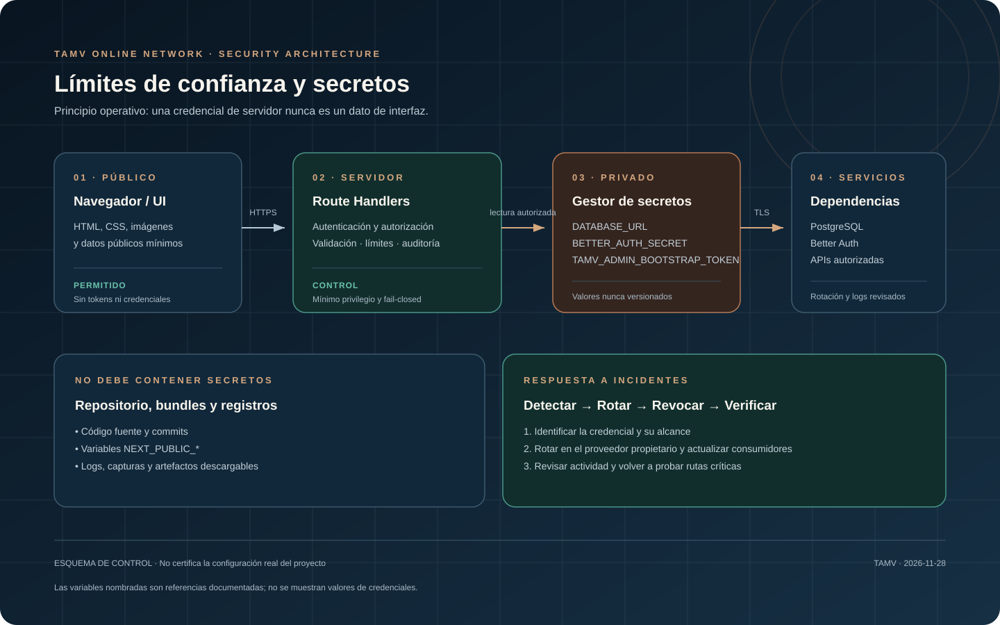

# TAMV Online Network

**Tecnología Avanzada Mexicana Versátil · Territorio Autónomo de Memoria Viva**

TAMV Online Network es una iniciativa mexicana independiente para tecnología, investigación, memoria territorial, gobernanza digital y sistemas de evidencia. Este repositorio contiene la aplicación web institucional, sus contratos API, pruebas, migraciones y documentación técnica.

- **Repositorio:** [OsoPanda1/desarrollo-tamv-online-network](https://github.com/OsoPanda1/desarrollo-tamv-online-network)
- **Vista de referencia:** [desarrollo-tamv-online-network.vercel.app](https://desarrollo-tamv-online-network.vercel.app/)
- **Rama principal:** `main`
- **Licencia de software:** Apache-2.0 en LICENSE, según [LICENSE](LICENSE) y con el alcance descrito en [LICENSES.md](LICENSES.md).

> Este README describe el código y la documentación de una revisión concreta. No constituye una certificación de seguridad, una declaración de cumplimiento legal, una acreditación externa ni una garantía de que el despliegue visible corresponda al commit local más reciente.

## Estado actual

El repositorio implementa una plataforma Next.js bilingüe con navegación por audiencias, guía de inicio, investigación, atlas territorial, portal de propuestas, gobernanza, formación, membresías y un hub soberano de protección digital y gobernanza de IA.

La distinción de estados es obligatoria:

1. **Declarado:** información editorial, metadatos o intención del proyecto.
2. **Implementado:** código o configuración presentes en el repositorio.
3. **Probado:** comportamiento respaldado por una ejecución reproducible.
4. **Desplegado:** versión disponible en un entorno identificado.
5. **Verificado externamente:** resultado emitido o confirmado por un tercero identificable.

Una ruta, un catálogo, un hash, un DOI, un ORCID o una puntuación interna no prueban por sí solos producción, integración remota, revisión por pares, titularidad o certificación.

## Capacidades principales

- **Experiencia institucional ES/EN:** navegación superior, navegación izquierda para personas y derecha para organizaciones, academias e instituciones, ambas plegables.
- **Guía y onboarding:** tutorial por pasos conectado con rutas reales de investigación, publicación, formación, apoyo y participación.
- **Living Atlas y HCU:** visualización territorial, grafo público, simulador y alternativas de lectura. Las posiciones y métricas son codificaciones descriptivas, no pruebas de causalidad.
- **Investigación y portal:** proyectos, publicaciones, perfiles opt-in, propuestas, consentimiento, evidencias, apelaciones y moderación con controles de servidor.
- **Gobernanza y evidencia:** evaluador LATAMV, estándar de integridad, recibos TPVA y dossier de auditoría con límites explícitos.
- **Soberanía digital e IA:** marco público `TAMV-SD-AI`, bibliografía consultable y protocolo de solicitud de auditoría externa.
- **Formación y comunidad:** módulos de aprendizaje, progreso para usuarios autenticados y superficies de participación.
- **Membresías y apoyo:** contratos de checkout, webhook, portal y estado de suscripción; el billing está deshabilitado por defecto y no se simulan pagos.
- **API pública y federación:** salud, investigación, HCU, exportaciones, ecosistema, procedencia y metadatos públicos con contratos documentados.

La presencia de una superficie no demuestra que todos sus proveedores, secretos, migraciones o permisos estén configurados en un entorno productivo.

## Arquitectura y stack

| Capa | Implementación actual |
|---|---|
| Framework | Next.js 16.4.6, App Router y Turbopack |
| UI | React y React DOM 19.3.1 |
| Lenguaje | TypeScript 7.0.2 |
| Paquetes | pnpm 12.16.1 y `pnpm-lock.yaml` |
| Persistencia | PostgreSQL con `pg` y Drizzle ORM |
| Autenticación | Better Auth, email/password y sesiones |
| Validación | Zod y validación de límites en el servidor |
| IA | AI SDK 7 y `@ai-sdk/react` |
| Criptografía | `jose` y utilidades de evidencia del proyecto |
| API | Route Handlers de Next.js y contrato OpenAPI |
| Pruebas | `node:test` con ejecución directa de TypeScript |
| Observabilidad web | Vercel Analytics y Speed Insights, sólo en producción |
| Estilos | CSS por superficie, PostCSS y Tailwind 4 |

La revisión contiene **48 archivos de página**, **44 archivos de ruta API**, **53 archivos de prueba** y **siete migraciones SQL**. Estos conteos describen el árbol del repositorio, no el número de endpoints expuestos sin autorización.

### Organización del código

- `app/`: páginas, layouts, metadatos, sitemap y Route Handlers.
- `components/`: shell institucional, navegación, visualizaciones y componentes de investigación.
- `lib/`: acceso a datos, autorización, gobernanza, pruebas, i18n, SEO y utilidades HTTP.
- `migrations/`: cambios de esquema numerados; se aplican mediante el flujo del proyecto.
- `public/`: recursos públicos, OpenAPI, bibliografía fuente y evidencia de build.
- `scripts/`: generación determinista, migraciones, preflight y evidencia.
- `tests/`: contratos, seguridad, gobernanza, navegación y regresiones.
- `docs/`: arquitectura, operaciones, investigación, seguridad, legal y hoja de ruta.

## Superficies de la aplicación

| Área | Rutas representativas |
|---|---|
| Inicio y guía | `/`, `/guia`, `/atlas`, `/hcu`, `/portal/hcu` |
| Identidad y territorio | `/quienes-somos`, `/origenes`, `/logros`, `/utamv`, `/isabella` |
| Investigación | `/investigacion`, `/investigacion/publicaciones`, `/investigadores`, `/fuentes`, `/proyectos` |
| Gobernanza | `/gobernanza`, `/soberania-digital`, `/estandar`, `/auditoria-creator` |
| Ecosistema técnico | `/arquitectura`, `/ecosistema`, `/desarrolladores`, `/desarrolladores/independiente` |
| Formación y participación | `/formacion`, `/comunidad`, `/membresias`, `/apoyar`, `/unete` |
| Portal y cuenta | `/portal`, `/portal/perfil`, `/portal/propuestas`, `/cuenta`, `/sign-in`, `/sign-up` |
| Institucional | `/institucionalizacion`, `/excelencia`, `/privacidad`, `/membresias/condiciones` |

Las rutas protegidas requieren sesión y autorización. Una URL accesible o un enlace de navegación no concede permisos.

## HCU y visualización territorial

El Observatorio HCU utiliza un grafo público respaldado por PostgreSQL y ofrece visualización interactiva, simulador y lectura alternativa. El archivo `graph.js` del sitio institucional estático es documental y no se sincroniza automáticamente con el grafo de la aplicación.

Las métricas y posiciones visuales son codificaciones descriptivas: no constituyen predicciones causales ni validación científica independiente. El apoyo institucional a esta superficie debe conservar fuente, versión, licencia y límites de uso de cada dato.

Especificación: [HCU Observatory v2](docs/architecture/hcu-observatory-v2.md).

## Sistema visual tecnológico y recursos de investigación

La portada y la galería principal priorizan investigación, ciencia abierta, gobernanza de IA, seguridad Zero Trust, integridad criptográfica, procedencia del conocimiento y supervisión humana. Los diagramas originales están en [`public/visuals/`](public/visuals/) y usan recursos locales en lugar de depender de imágenes remotas para estos temas.

Los SVG son **diagramas conceptuales**, no capturas de producción, certificaciones, mediciones científicas ni resultados de auditoría. El territorio y la identidad de Real del Monte permanecen en las secciones de Orígenes, RDM Digital y Atlas territorial, donde aportan contexto.

- [Auditoría del sistema visual tecnológico](docs/audit/2026-11-28-research-first-visual-system.md)
- [Auditoría de perfiles públicos, biografía fundacional y readiness de producción](docs/audit/2026-11-28-founder-profile-and-release-readiness.md)
- [Observatorio HCU](app/hcu/page.tsx)
- [Galería visual temática](components/tamv-visual-systems.tsx)

## Soberanía digital y gobernanza de IA

La ruta [`/soberania-digital`](app/soberania-digital/page.tsx) unifica el marco **TAMV-SD-AI v1.0**, declarado como **borrador público**, no como ley, reglamento, certificación o declaración de cumplimiento.

Contenido implementado:

- Ocho principios soberanos.
- Cinco capas: infraestructura/cómputo, datos/conocimiento, modelos/cadenas de suministro, decisiones/personas y ecosistema/dependencias.
- Ciclo operativo: gobernar, mapear, medir y gestionar.
- Ocho métodos, ocho controles de gobernanza de IA y seis compromisos decoloniales.
- Nueve pasos de protocolo de auditoría y ocho reglas de acceso.
- Referencias normativas, glosario, limitaciones y mapa de implementación.
- Bibliografía bilingüe con búsqueda, filtros, ordenación y paginación local.

### Bibliografía y procedencia

La fuente pública es [`public/research/soberania-digital/search-papers.bib`](public/research/soberania-digital/search-papers.bib):

- **364 registros BibTeX.**
- **100646 bytes.**
- **SHA-256:** `366fdc0e2ac88fdd5766965d0ee031378919fa7d26170b5b50aaad5003d23eed`.
- Cobertura declarada: 2014–2026; 352 registros con DOI; 212 de 2024–2026.

El generador [`scripts/build-sovereignty-bibliography.mjs`](scripts/build-sovereignty-bibliography.mjs) conserva la fuente exacta, rechaza campos y claves duplicados, preserva registros no anglófonos, proyecta únicamente URL HTTPS sin credenciales y señala metadatos inciertos en lugar de corregirlos silenciosamente. El resultado determinista está en [`data/governance/digital-sovereignty-bibliography.json`](data/governance/digital-sovereignty-bibliography.json).

Los temas son inferencia editorial a partir de títulos y mapeos curados; no son palabras clave de autores, clasificación de revisión por pares ni validación científica. El corpus no se declara exhaustivo, sistemático, representativo ni completamente revisado por pares. La presencia de DOI no verifica resolución, autoría, calidad o licencia de reutilización.

Para comprobar la integridad de la fuente y del manifiesto:

```bash
node scripts/build-sovereignty-bibliography.mjs --check
```

### Auditoría externa: límite operativo

El hub incluye un generador local de solicitud o aviso de auditoría externa. Crea un borrador en memoria, permite copiarlo o descargarlo y abre un correo con **sólo el asunto**. No envía datos, no abre casos, no asigna auditores, no concede permisos ni persiste el formulario.

Una solicitud o aviso es necesaria pero no suficiente. El protocolo exige revisar identidad, mandato, independencia, conflictos, alcance, versión, criterios, confidencialidad, minimización, acceso temporal de mínimo privilegio, supervisión, registro, hallazgos, respuesta, remediación, re-prueba, apelación y revocación.

**No existen actualmente un rol de auditor externo, gestión de casos, concesión de acceso, anexos confidenciales, portal de auditor ni cierre auditado.**

## Gobernanza, procedencia y evidencia

### LATAMV 2.0

[`lib/governance/latamv-v2.ts`](lib/governance/latamv-v2.ts) implementa un evaluador local determinista documentado en [`docs/governance/latamv-v2-specification.md`](docs/governance/latamv-v2-specification.md).

Sus límites son explícitos:

- `requiredApprovals()` calcula cantidades; no verifica identidades ni firmas.
- `signatureMetadata` es metadato declarativo, no prueba criptográfica.
- `verifyRuntimeProvenance()` no está integrado.
- No se presentan como implementados ZK, quórum criptográfico real, auto-sanación, pasaporte soberano, negociación jurisdiccional ejecutable ni cumplimiento legal.

### TPVA — TAMV Proof & Verification Atlas

La Fase 1 incluye contrato de recibo, esquema JSON, canonicalización determinista, hash SHA-256, validación estricta, verificador offline fail-closed, vectores y pruebas.

- [Contrato TPVA v1](docs/specs/tpva-receipt-v1.md)
- [Esquema JSON](docs/specs/tpva-receipt-v1.schema.json)
- [Blueprint](docs/security-review/TPVA_MASTER_BLUEPRINT.md)

La firma cubre los bytes canónicos definidos por el contrato. Los estados `VERIFIED`, `WITH NOTES`, `FAILED`, `UNVERIFIED` y `REVOKED` son estados de evidencia interna, no sellos externos. Las fases de empaquetado, KMS/HSM, persistencia append-only, API pública, UI pública y federación siguen sujetas a su propia evidencia de implementación.

### Estándar de integridad

La ruta `/estandar` y sus endpoints exponen el estándar TAMV y su evaluador. Una evaluación automatizada no sustituye revisión jurídica, auditoría independiente ni autorización humana.

## API pública y federación

El contrato machine-readable está en [`public/openapi.yaml`](public/openapi.yaml) y la guía en [`docs/api/public-api-quickstart.md`](docs/api/public-api-quickstart.md).

| Método y ruta | Alcance |
|---|---|
| `GET /api/health` | Liveness, independiente de PostgreSQL |
| `GET /api/health/ready` | Readiness con PostgreSQL; responde 503 si la dependencia no está disponible |
| `GET /api/v1/research/topics` | Catálogo público de temas |
| `GET /api/v1/research/projects` | Proyectos públicos |
| `GET /api/v1/researchers` | Perfiles opt-in |
| `GET /api/v1/hcu/graph` | Grafo declarativo HCU |
| `GET /api/v1/exports/research` | Exportaciones JSON-LD/CSV |
| `GET /api/v1/ecosystem` | Catálogo de sistemas |
| `GET /api/v1/ecosystem/metadata` | Metadatos públicos de GitHub con dominio fijo |
| `GET /api/v1/huggingface` | Snapshot local de metadatos públicos; sin llamadas al Hub en runtime |
| `POST /api/v1/provenance/validate` | Validación de envelope; no prueba autoría |
| `POST /api/v1/research/federated` | Puente institucional, deshabilitado sin URL HTTPS configurada |

Los estados del catálogo separan `catalogued`, `contracted`, `adapter_implemented` y `verified`. Un sistema catalogado no debe describirse como integrado o verificado sin evidencia reciente.

Las rutas de autenticación, billing, LGS, moderación, asistentes y administración tienen controles y requisitos de configuración independientes. El acceso público no se extiende a ellas por aparecer en el árbol de `app/api`.

### Snapshot de Hugging Face

El snapshot se genera con `pnpm hf:snapshot` y se valida en `lib/huggingface/public-snapshot.ts`. No guarda tokens, repositorios privados o gated, pesos, embeddings ni resultados de inferencia. El endpoint lee el snapshot local; un listado público no demuestra evaluación, adopción, licencia para un uso concreto o revisión externa.

## Base de datos y operaciones

- PostgreSQL es la persistencia principal documentada.
- Drizzle ORM administra el acceso desde el código.
- `PG_POOL_MAX` admite enteros de 1 a 20; el valor por defecto es 3.
- `pnpm db:preflight` es de sólo lectura.
- `pnpm db:migrate` ejecuta el flujo de migraciones con sus comprobaciones.
- La migración `0004_public_rate_limits.sql` debe existir en el entorno correcto. Si el almacén de rate limits no está disponible, el limitador puede responder 503 de forma fail-closed.
- La migración `0005_lgs_audit_events.sql` y el resto del esquema deben verificarse en staging antes de producción.

No ejecutes migraciones contra producción como parte de una validación local. No compartas cadenas de conexión, tokens, dumps ni datos personales en issues o PR. Antes de una migración se requiere identificar el destino, ejecutar preflight, respaldo, restauración ensayada y plan de reversión.

## Desarrollo local

### Requisitos

- Node.js compatible con Next.js 16.4.6 y el lockfile.
- pnpm 12.16.1, conforme a `packageManager`.
- PostgreSQL de desarrollo o pruebas para comprobar rutas que requieren persistencia.

### Instalación y comandos

```bash
pnpm install --frozen-lockfile
pnpm test
pnpm typecheck
pnpm build
pnpm dev
```

Comandos adicionales:

```bash
pnpm db:preflight
pnpm db:migrate
pnpm db:migrate:plan
pnpm standard:check
pnpm hf:snapshot
node scripts/build-sovereignty-bibliography.mjs --check
```

El build ejecuta esta secuencia:

```bash
node scripts/write-build-evidence.mjs --clear && next build && node scripts/write-build-evidence.mjs
```

[`public/build-evidence.json`](public/build-evidence.json) contiene un SHA-512 calculado sobre los bytes exactos de `BUILD_ID` y los manifiestos seleccionados de Next.js. No es un digest del despliegue completo, una firma digital, un timestamp confiable ni evidencia de que CI haya pasado.

### Variables de entorno

Copia [`.env.example`](.env.example) a `.env.local` y sustituye los placeholders sólo en tu entorno local. Nunca subas archivos `.env` reales.

Configuración mínima para una revisión local con base de datos y autenticación:

- `DATABASE_URL`
- `PG_POOL_MAX`
- `BETTER_AUTH_URL`
- `BETTER_AUTH_SECRET`
- `APP_URL`
- `TAMV_RATE_LIMIT_ENABLED` y `TAMV_RATE_LIMIT_SALT` cuando el limitador esté habilitado

Configuraciones opcionales y deshabilitadas por defecto:

- TAMV Pass y claves de identidad.
- Stripe, webhook, impuestos y aprobaciones legales de membresía.
- URL de donación.
- Puente de investigación institucional.
- Acceso de fundador y especificación privada LGS.

En producción, `BETTER_AUTH_URL` y `BETTER_AUTH_SECRET` deben configurarse en el gestor de secretos. Un build local puede advertir sobre su ausencia; esa advertencia no debe interpretarse como autenticación productiva validada.

## Seguridad y preparación para producción

Los controles se organizan en tres planos:

1. **Datos y criptografía:** TLS, hashes, minimización, rotación y recuperación según el entorno.
2. **Aplicación e identidad:** autorización deny-by-default, validación server-side, sesiones, límites de cuerpo, same-origin, rate limits y redirecciones seguras.
3. **Gobernanza y operación:** consentimiento, retención, moderación, apelaciones, aprobaciones y gestión de incidentes.

Documentos principales:

- [Triple hardening](docs/security/triple-hardening.md)
- [Controles de triple hardening](docs/security/triple-hardening-controls.md)
- [Release readiness](docs/security/release-readiness.md)
- [Runbook de rate limits](docs/OPERATIONS-0004-PUBLIC-RATE-LIMITS.md)
- [Runbook de membresías](docs/production/membership-billing-runbook.md)
- [Matriz de cierre modular](docs/roadmap/module-completion-matrix-2026-11.md)

Antes de una liberación productiva se debe verificar, como mínimo:

- Secretos y orígenes canónicos configurados fuera del repositorio.
- Instalación congelada, pruebas, typecheck, build, auditoría de dependencias, CodeQL y secret scan asociados al SHA candidato.
- Migraciones y rate limits demostrados en staging.
- Backup y restauración ensayados.
- Autorización, aislamiento de datos, privacidad, consentimiento, retirada y apelación probados con sesiones de prueba.
- Billing en sandbox, conciliación e idempotencia verificadas antes de cobrar.
- Smoke tests de liveness/readiness y flujos críticos en el despliegue candidato.
- Observabilidad sin secretos ni datos personales innecesarios.
- Revisión jurídica de privacidad, términos, marca, afiliaciones y cadena de titularidad.
- Estado real del despliegue y métricas observadas; no declarar métricas sin tráfico medido.

No se declara que el sistema esté al 100 % en producción, que tenga seguridad absoluta, no-repudio, cumplimiento normativo, PQC efectivo o certificación externa.

## Validación local de esta revisión

Ejecución local realizada el **28 de noviembre de 2026** sobre el candidato de esta revisión:

| Comprobación | Resultado |
|---|---|
| `pnpm test` | 369 pruebas, 369 aprobadas, 0 fallos |
| `pnpm typecheck` | Correcto |
| `pnpm build` | Correcto |
| Biblioteca `--check` | Correcta; 364 registros y bytes/hash exactos |
| Huella de evidencia de build | Recomcalculada y coincidente |
| `git diff --check` | Correcto |
| Escaneo de secretos de los archivos del cambio | Sin hallazgos |
| HTTP local ES/EN de `/` y `/soberania-digital` | 200 |
| Fuente BibTeX servida | 200; 100646 bytes y SHA-256 esperado |
| Estructura DOM de inicio y hub | Sin IDs duplicados |
| Formulario de auditoría renderizado | `method="dialog"`, sin `action` ni envío remoto |

La verificación visual e interactiva en navegador —incluidos teclado, reduced-motion, 320 px, filtros, copia, descarga y mailto— sigue pendiente cuando el viewport nativo no está disponible. Los resultados locales no sustituyen CI, staging, producción ni revisión externa.

## Membresías y pagos

### Formación y apoyo

- Plan individual documentado: **MXN 229/mes por usuario**.
- Plan business documentado: **MXN 699/mes por organización**.
- Formación: cinco módulos prácticos con progreso para usuarios autenticados.
- El plan business está ligado al usuario contratante y al nombre de organización; no se declaran seats, invitaciones ni transferencia de acceso a empleados como implementados.
- `/apoyar` muestra un estado transparente cuando no hay proveedor configurado; no simula pagos ni solicita datos bancarios.
- Los enlaces de AI Lounge son referencias de descubrimiento, no prueba de pase, patrocinio, afiliación o autorización.
- ROR es una meta institucional futura; un identificador ROR no equivale a constitución legal ni verificación criptográfica.

Antes de activar cobros, revisa el [runbook de membresías](docs/production/membership-billing-runbook.md) y la [auditoría de despliegue y membresías](docs/audit/2026-11-23-production-deployment-memberships-audit.md).

## Pruebas visuales y Meticulous

La integración con Meticulous está preparada como complemento para reproducción de sesiones y regresiones visuales/DOM. No sustituye tests, typecheck, seguridad ni validación de despliegue.

- [Guía de integración](docs/qa/METICULOUS-INTEGRATION.md)
- [Workflow manual](.github/workflows/meticulous-agent-swarm.yml)

No se afirma que el proyecto Meticulous esté conectado, que el recorder esté instalado o que exista una ejecución satisfactoria. Las grabaciones deben usar staging y cuentas sintéticas; nunca datos personales reales, credenciales administrativas ni tokens.

## Licenciamiento híbrido y derechos

La propuesta distingue capas que no se aplican automáticamente al mismo activo:

| Capa | Instrumento | Estado |
|---|---|---|
| Software original público | Apache-2.0 | `LICENSE` existe; el alcance por activo requiere revisión |
| Documentación editorial identificada | CC BY 4.0 | No se aplica por extensión a todo `docs/` |
| Datasets públicos seleccionados | ODbL 1.0 | Reservada para datasets revisados y autorizados |
| Activos privados enumerados | Borrador de licencia privada TAMV | No aprobado ni firmado |
| Marca y afiliación | Política y autorizaciones separadas | Borrador pendiente de verificación |
| Datos personales | Avisos y contratos de tratamiento | No los resuelve una licencia de software |

Referencias:

- [Mapa de licencias](LICENSES/README.md)
- [Estado de licenciamiento](docs/governance/licensing-status.md)
- [Plan de implementación](docs/legal/LICENSING-IMPLEMENTATION-PLAN.md)
- [Registro de activos](docs/legal/asset-register.csv)

El registro inicial está marcado `UNREVIEWED` y no prueba titularidad. La licencia privada no puede revocar retroactivamente derechos concedidos válidamente bajo Apache-2.0. CC BY no debe usarse para software. ODbL no autoriza por sí sola divulgar datos personales ni resolver todos los derechos de contenido individual.

**Revisión profesional pendiente:** la política final, la cadena de titularidad, los contratos de contribución, la protección de datos, las condiciones de membresía y los derechos de marca requieren asesoría jurídica cualificada en México antes de adoptarse como vinculantes.

## Limitaciones conocidas

- La validación CI, el despliegue productivo y las operaciones externas no se dan por verificados por este README.
- La configuración productiva de Better Auth, secretos, cookies y orígenes requiere evidencia del entorno.
- Migraciones, backup/restauración, rate limits y billing requieren staging y configuración autorizados.
- Los conectores académicos e institucionales conservan estados separados de catálogo, contrato, adaptador y verificación.
- HCU y Atlas no constituyen modelos causales validados ni un gemelo territorial productivo.
- TPVA Fase 1 no equivale a certificación externa; sus fases posteriores tienen estados independientes.
- No existe un flujo operativo de auditor externo, casos, permisos temporales, anexos confidenciales ni portal auditor.
- No se declaran seats empresariales, comunidad multiusuario persistente, memoria durable de IA ni agentes en producción sin evidencia específica.
- Las métricas de rendimiento y uso no se declaran sin observación real.
- La revisión visual e interactiva completa sigue pendiente.

La hoja de ruta y las dependencias de cierre están en [`docs/roadmap/module-completion-matrix-2026-11.md`](docs/roadmap/module-completion-matrix-2026-11.md).

## Seguridad de secretos y activos visuales

La auditoría de límites de secretos del 28 de noviembre de 2026 documenta el estado de evidencia, los controles de código observados y el procedimiento para responder a una posible exposición. La lectura de variables de Vercel no estuvo disponible durante esa revisión; por ello no se afirma ni una filtración confirmada ni ausencia de filtraciones.

- [Auditoría de límites de secretos y activos](docs/audit/2026-11-28-secret-boundary-and-assets-audit.md)
- [Workflow de escaneo histórico de secretos](.github/workflows/secret-scan.yml)
- [Inventario y procedencia de imágenes del hub](docs/audit/hub-images-mapping.md)



**Regla operativa:** no guardar valores reales en Git, `NEXT_PUBLIC_*`, documentación, capturas o logs. Si una credencial pudo exponerse, rotarla en el proveedor propietario, revocar la anterior, actualizar consumidores y revisar actividad antes de cerrar el incidente.

## Contribuir

Consulta [`CONTRIBUTING.md`](CONTRIBUTING.md) antes de abrir un pull request.

- Explica el problema, reproducción y criterio de aceptación.
- Añade pruebas relevantes y reporta sólo resultados ejecutados.
- Documenta cambios de API, migraciones, variables de entorno y riesgos.
- Identifica origen, licencia y versión de materiales externos.
- No subas secretos, credenciales, datos personales ni activos sin autorización de publicación.
- No afirmes certificación, afiliación, titularidad o cumplimiento sin evidencia verificable.
- Mantén alineadas las versiones en español e inglés cuando ambas existan.

## Investigación, contacto y seguridad

Conserva URL canónica, identificador, fecha de consulta, versión inspeccionada, licencia y estado de revisión para cada fuente. Distingue títulos localizados de textos completos efectivamente revisados.

No publiques vulnerabilidades explotables, tokens, datos personales ni registros privados en issues públicos. Usa el mecanismo privado de reporte de vulnerabilidades de GitHub si está habilitado, o un canal institucional verificado. No asumas que un reporte fue recibido sin confirmación explícita.

Las descripciones, estados de madurez, integraciones, licencias y métricas deben interpretarse respecto del commit, el entorno y la evidencia concreta. Este README no sustituye contratos, licencias completas, avisos de privacidad, documentación de terceros ni una auditoría independiente.
